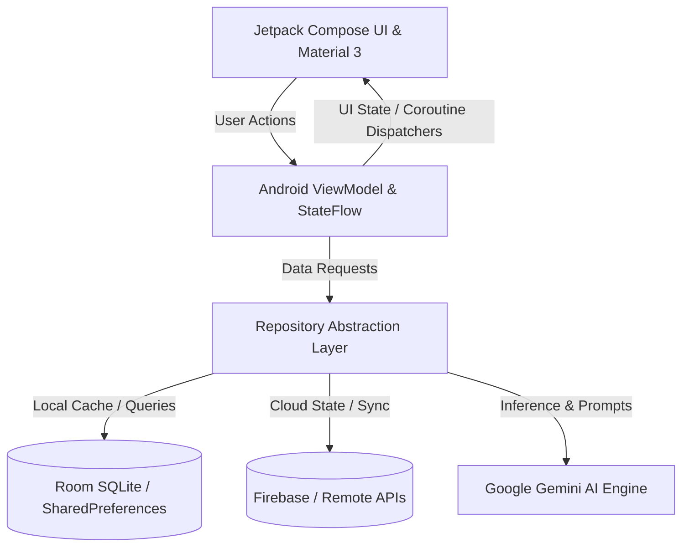

# Aurelion Industrial OS

> **AI-Powered Chemical Engineering & Legacy Oilworks Industrial Operating System**  
> *Engineered by **[Aditya Mehra](https://adityamehra007.github.io)** | Bengaluru, Karnataka, India*  
> *Portfolio:* [adityamehra007.github.io](https://adityamehra007.github.io) | *Flagship System:* [AdityaMehra007/anti](https://github.com/AdityaMehra007/anti)

[](LICENSE)
[](https://kotlinlang.org/)
[](https://developer.android.com/jetpack/compose)
[](https://ai.google.dev/)
[](https://developer.android.com/)
[](https://developer.android.com/topic/architecture)

---

## 📌 Executive Overview

**Aurelion Industrial OS** is a production-grade Android mobile application and operational platform engineered using modern **Kotlin 2.0+**, **Jetpack Compose (Material 3)**, and integrated **Google Gemini AI** intelligence.

Designed to solve complex real-world workflows with deterministic software reliability, **Aurelion Industrial OS** combines responsive reactive UI state machines, robust offline-first local persistence, and cloud AI inference to deliver an elite digital experience.

---

## 🏗️ Core Architecture & Technical Design

The platform strictly follows Android's recommended **Clean Architecture & MVVM** paradigm with unidirectional data flow (UDF):



### Architectural Tenets
1. **Zero Vibe Coding & Predictable State**: State is modeled strictly via immutable Kotlin data classes and exposed via Kotlin `StateFlow`.
2. **Deep Modules**: High cohesion within feature domains; UI components communicate with repositories exclusively through clear, testable interfaces.
3. **Hardware & Battery Optimization**: Minimal memory overhead, zero redundant recompositions, and non-blocking asynchronous I/O via Kotlin Coroutines on `Dispatchers.IO`.
4. **Resilient Network & AI Tier**: Graceful fallback patterns for network partitions and rate limits on LLM API endpoints.

---

## 🚀 Key Modules & Capabilities

### Digital Twin & Process Flow
Real-time visual monitoring of refinery towers, catalytic cracking units, pipelines, and heat exchangers with live pressure, temperature, and throughput indicators.

### Inventory & Tank Telemetry
High-precision volumetric tank telemetry tracking crude stock, intermediate distillates, finished fuel reserves, and automated ullage calculations.

### LIMS (Laboratory Information Management)
Automated testing logbook for viscosity, sulfur content, flash points, and API gravity compliance with ASTM standards.

### Compliance & Financial Modeling
Operational cost modeling, crude yield economics, environmental compliance audit logs, and refinery margin optimization algorithms.

### Archive AI & Knowledge Vault
Integrated Gemini AI copilot for querying decades of legacy operational schematics, standard operating procedures (SOPs), and incident mitigation playbooks.

### Process Engineering Calculators
Embedded thermodynamic and hydraulic calculation suite for flow rates, vapor pressure, heat duty, and pressure drops across complex valve networks.

---

## 📱 Primary Screens & Visual Components

Key Compose screens and interface destinations include:
`DigitalTwinScreen`, `InventoryTankScreen`, `LimsScreen`, `ComplianceFinanceScreen`, `CalculatorsScreen`, `ArchiveAiScreen`, `DashboardScreen`

Each screen incorporates custom Material 3 typography, fluid gestures, dark/light theme elevation surfaces, and accessible semantics.

---

## 🛠️ Technology Stack & Dependencies

| Layer | Technologies |
|---|---|
| **Core Language** | Kotlin 2.0+ (100% Kotlin codebase) |
| **UI Framework** | Jetpack Compose, Material 3, Foundation, Animation |
| **Asynchronous Engine** | Kotlin Coroutines & Asynchronous Flow (`StateFlow`, `SharedFlow`) |
| **Architecture** | ViewModel, Lifecycle Runtime, Navigation Compose |
| **Persistence** | Room Database (SQLite) / Firebase Firestore / DataStore |
| **AI Integration** | Google Gemini Generative AI SDK |
| **Build & Tooling** | Gradle Kotlin DSL (`build.gradle.kts`), Android Studio |

---

## 💻 Getting Started & Local Build

### Prerequisites
- **Android Studio** Hedgehog (2023.1.1) or newer
- **JDK 17** (LTS) or higher
- **Android SDK** API Level 34 installed

### Installation & Run

1. **Clone the repository**:
   ```bash
   git clone https://github.com/AdityaMehra007/PROJECT-AURELION-THE-LEGACY-OILWORKS-INTELLIGENCE-PLATFORM.git
   cd PROJECT-AURELION-THE-LEGACY-OILWORKS-INTELLIGENCE-PLATFORM
   ```

2. **Configure Environment Keys**:
   Create or update `local.properties` in the project root:
   ```properties
   gemini.api.key=YOUR_GOOGLE_GEMINI_API_KEY
   ```

3. **Build the Debug APK**:
   ```bash
   # Windows PowerShell
   .\gradlew.bat assembleDebug

   # macOS / Linux
   ./gradlew assembleDebug
   ```

4. **Execute Unit Tests**:
   ```bash
   .\gradlew.bat test
   ```

---

## 👤 Engineering & Operational Leadership

**Aditya Mehra**  
*Strategic Operations Leader & Systems Architect*  
- **Alma Mater**: BBA International Business, Dayananda Sagar University (DSU), Bengaluru  
- **GitHub**: [@AdityaMehra007](https://github.com/AdityaMehra007)  
- **Portfolio & Mission Control**: [https://adityamehra007.github.io](https://adityamehra007.github.io)  
- **Flagship Autonomous System**: [AdityaMehra007/anti](https://github.com/AdityaMehra007/anti)

---

## 📄 License

This repository is distributed under the **MIT License**. See [LICENSE](LICENSE) for complete terms.
